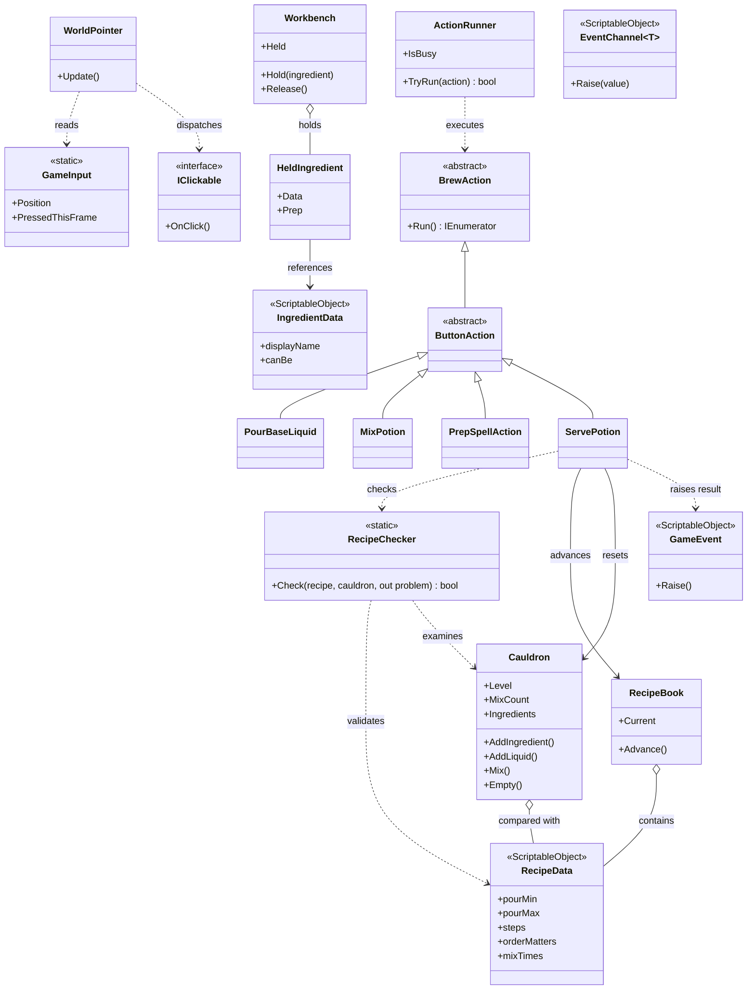

# The Alchemist's Missing Pages — Assignment 4

> **Status:** Playable single-level prototype.

## Game concept and core loop

*The Alchemist's Missing Pages* is a puzzle game about reconstructing potion recipes from an ancient spellbook with missing information. The player experiments with ingredients, preparation spells, liquid quantities, mixing, and ingredient order. Failed attempts produce specific feedback, helping the player deduce the correct recipe rather than simply restarting without guidance.

**Core loop:**

1. Open the recipe book and read the available instructions.
2. Select an ingredient from the shelf.
3. Optionally prepare it using **SLICE** or **HEAT**.
4. Add ingredients to the cauldron; pour base liquid and stir as needed.
5. Press **SERVE** to test the potion against the current recipe.
6. Use the success or failure feedback to adjust the next attempt. Successful brewing advances to the next recipe; after the last recipe, the book cycles back to the first.

## Requirements and setup

1. Open the project folder in **Unity Hub** using **Unity 6000.3.25f1** (the version recorded in `ProjectSettings/ProjectVersion.txt`), or a compatible Unity 6 installation.
2. Allow Unity to import the project and resolve packages.
3. Open `Assets/Scenes/PotionLab.unity`.
4. Press **Play** to try the included scene.

## Controls

| Input | Action |
|---|---|
| Mouse click / touch | Select a shelf ingredient or interact with a scene object |
| On-screen action buttons | Prepare an ingredient, add it to the pot, pour, mix, or serve (depending on context) |
| **STOP** during pouring | Stop adding base liquid at the desired amount |
| **Esc / Back** | Invoke the current back-navigation behavior where available |

The game is **pointer-driven**: it does not use WASD character movement. `GameInput.cs` supports both mouse and touch, and `WorldPointer.cs` prevents clicks on UI elements from passing through to world objects.

## Walkthrough: brewing a potion

The current scene is a **recipe-solving tutorial/workflow**, not a character-movement level. Follow the visible recipe instructions and use the on-screen controls to perform each brewing step.

1. **Read the recipe.** Open the spellbook and identify the available hints, ingredients, preparation requirements, and liquid quantities.
2. **Select an ingredient.** Click or tap an item on the shelf; it becomes the ingredient held at the workbench.
3. **Prepare it if needed.** Use **SLICE** or **HEAT** where permitted. The game tracks the preparation state.
4. **Add it to the cauldron.** Repeat for each ingredient, paying attention to the order when the recipe requires it.
5. **Pour and mix.** Pour the base liquid and use **STOP** to end pouring at the desired quantity; stir the potion as required.
6. **Serve and learn.** Press **SERVE**. `RecipeChecker` evaluates the result and provides a specific reason when the attempt fails. A successful potion advances the recipe book.

**Win/progression condition:** The cauldron state must satisfy the active `RecipeData` (ingredients, preparation, liquid range, ordering where relevant, and mix count). This is not a timed Sherlock-style verdict or an exit-gate puzzle.

## Physics used

This project uses **Unity 2D collision queries for pointer interaction**, not a pushable 3D Rigidbody puzzle:

- `WorldPointer` converts the mouse/touch position from screen coordinates to world coordinates with `Camera.ScreenToWorldPoint`.
- It identifies clickable world objects using **`Physics2D.OverlapPoint`** and their **`Collider2D`** components.
- `IClickable` and `IHoverable` separate input detection from object behavior.
- The ingredient flight, pouring, and spell visuals are primarily **coroutine-driven animations**, not evidence of `Rigidbody.AddForce`-based motion.


## Project structure

```text
The-Alchemists-Missing-Pages/
├── Assets/
│   ├── Art/                    # Backgrounds, characters, ingredients, effects
│   ├── Editor/
│   │   ├── PotionLabMenu.cs    # Unity editor setup/build commands
│   │   ├── Data/               # Creates game data assets
│   │   ├── Import/             # Imports and slices sprite sheets
│   │   └── Scene/              # Builds the level and wires components
│   ├── Scenes/
│   │   └── PotionLab.unity     # Included playable scene
│   └── Scripts/
│       ├── Actions/            # Brewing commands and ActionRunner
│       ├── Animation/          # Frame-based animation
│       ├── Cauldron/           # Cauldron, liquid, kettle, vial, gauge
│       ├── Effects/            # Spell beams and effects
│       ├── Events/             # ScriptableObject event channels
│       ├── Game/               # Workbench and welcome message
│       ├── Ingredients/        # Ingredient data, selection, preparation
│       ├── Input/              # Mouse/touch pointer interaction
│       ├── Platform/           # Display, cursor, mobile behavior
│       ├── Recipes/            # Recipe assets, book, checker
│       ├── Student/            # Student character animation
│       └── UI/                 # Buttons, book, speech, journal, labels
├── Packages/
├── ProjectSettings/
├── Level_Design.md
├── Market_Research.md
├── formal-elements.md
└── README.md
```

## Visual design and gameplay presentation

The supplied Unity project includes a designed 2D alchemy lab rather than a runtime-generated 3D greybox room.

- **Scene:** `Assets/Scenes/PotionLab.unity` is the included laboratory scene.
- **Artwork:** `Assets/Art` contains the laboratory background, foreground, wizard/student character layers, ingredient sprites, and effects.
- **Interactions:** Shelf items, workbench, cauldron, recipe book, and on-screen action buttons support the brewing loop.
- **Feedback:** Character animation, frame effects, spell beams, and potion colors make actions and outcomes visible.
- **Scene authoring:** Editor tools under `Assets/Editor` can set up data and rebuild the scene. These are editor-time tools, not the same runtime scene generation used in the previous prototypes.

### Implemented gameplay systems

### Ingredients and preparation

- `IngredientData` is a **ScriptableObject** containing an ingredient's identity, visual sprites, tint, and supported preparation methods.
- `Prep` is a flags enum: `Raw`, `Sliced`, `Heated`, and `SlicedHeated`.
- `ShelfItem` represents an ingredient on the shelf; `HeldIngredient` represents the selected ingredient in the workspace.
- `Workbench` tracks the held ingredient and raises a `Changed` event when the selection or preparation changes.
- `PickUpIngredient`, `PutIngredientBack`, `PrepSpellAction`, and `DropIntoCauldron` implement the ingredient workflow.

### Brewing and recipe validation

- `Cauldron` stores the liquid level, potion color, added ingredients, and mix count. It raises `Changed` when its state changes.
- `RecipeData` is a **ScriptableObject** defining a recipe's liquid range, ingredients, preparation, order requirement, mixing count, and result color.
- `RecipeBook` tracks the current recipe and advances after successful brewing.
- `RecipeChecker.Check(recipe, cauldron, out problem)` is a **static, state-free validator**. It checks the liquid range, required ingredients, preparation, unexpected or repeated ingredients, ingredient order when relevant, and mixing count. It returns an explanatory problem message for an invalid attempt.
- `ServePotion` coordinates success and failure animations, feedback events, cauldron reset, and progression.

### Actions, animations, and events

- `BrewAction` is the abstract base for gameplay actions. Each action runs as a coroutine.
- `ActionRunner` permits **one brewing action at a time**, avoiding overlapping animations and conflicting state changes.
- `ButtonAction` listens for action-button events; specialized classes include `PourBaseLiquid`, `MixPotion`, `PrepSpellAction`, and `ServePotion`.
- `EventChannel<T>` and `GameEvent` provide **ScriptableObject-based event channels**, allowing buttons, gameplay logic, and UI to communicate without directly referencing every listener.
- `StudentAnimator`, `FramePlayer`, `EffectSpawner`, and `SpellBeam` manage character animation and visual feedback.

## Architecture and class relationships



### Key design decisions

1. **Single-responsibility components:** Actions, recipe validation, cauldron state, UI, and visual effects are separated into focused classes.
2. **Data-driven recipes:** `IngredientData` and `RecipeData` are ScriptableObjects, allowing recipe content to change without rewriting the validator.
3. **Event-driven communication:** Event channels and `Changed` notifications reduce direct coupling between game systems and UI.
4. **Serialized action execution:** `ActionRunner` prevents multiple brewing actions from executing simultaneously.
5. **Feedback as gameplay:** `RecipeChecker` returns a concrete error message, turning failed experiments into useful information.
6. **Cross-device input:** The same pointer workflow handles mouse and touch, with UI click filtering.

## Links

- **GitHub:** https://github.com/Gamedev-HW/The-Alchemists-Missing-Pages
- **itch.io:** https://gamedev-hw.itch.io/the-alchemists-missing-pages