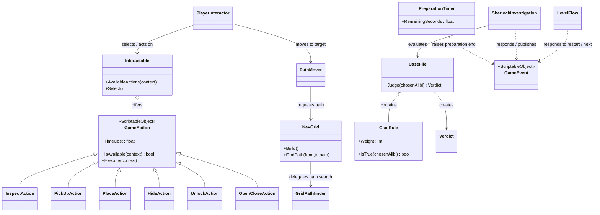

# The Wrong Suspect — Assignment 4 Unity Prototype

> **Status:** Playable single-level prototype.

## 1. Game concept and core loop

**The Wrong Suspect** is a 2D mystery/stealth puzzle game in which the player is the criminal. Before Sherlock Holmes arrives, the player changes the crime scene, conceals incriminating evidence, plants misleading clues, and—when offered—chooses an alibi. Sherlock then examines the clues and accuses a suspect.

**Core loop:** inspect the scene → click to move and interact → spend limited preparation time on actions → end preparation (or run out of time) → choose an alibi when prompted → watch Sherlock investigate → receive a verdict → retry or continue.

## 2. Requirements and setup

- **Engine:** Unity project using Universal Render Pipeline (URP), including 2D rendering packages.
- **Input:** Unity Input System (`com.unity.inputsystem` is included in `Packages/manifest.json`).
- **Source folders:** `Assets/Scripts`, `Assets/Scenes/Levels`, `Assets/Art`, `Assets/Prefabs` and project settings.

### Opening the project

1. Extract the ZIP and open its root folder in Unity Hub.
2. Allow Unity to import packages and compile the scripts.
3. If generated assets or scene references are missing, use **Tools → The Wrong Suspect → Build Art Assets**, then **Tools → The Wrong Suspect → Create Level Scenes**. **Caution:** the separate **Rebuild Art Assets** command can overwrite generated prefabs and Animator Controllers.
4. Open `Assets/Scenes/Levels/Level1_TheGloveLeftBehind.unity` and press **Play**.
5. Confirm all four levels are included in **Build Profiles → Scene List** before making a build. The scene-building tool also adds them to the build list.

## 3. Controls

| Input | Action |
| --- | --- |
| Left-click on the floor | Move the criminal toward the clicked location |
| Left-click an interactive object | Select it and open available actions |
| Action-menu buttons | Inspect, pick up, place, hide, unlock, or open/close, when available |
| End-preparation UI control | Finish preparing and start Sherlock's investigation |
| Alibi UI choices | Choose an alibi when the case offers one |
| Results UI controls | Restart the current level or advance |

## 4. Walkthrough and level progression

The project includes four scene files:

1. **Level 1 — The Glove Left Behind** (`Level1_TheGloveLeftBehind.unity`): introduction to inspecting and manipulating evidence.
2. **Level 2 — The Break-In That Never Happened** (`Level2_TheBreakInThatNeverHappened.unity`): arranging the scene to support a false break-in narrative.
3. **Level 3 — The Nine O'Clock Alibi** (`Level3_TheNineOclockAlibi.unity`): evidence and alibi choices must form a plausible timeline.
4. **Level 4 — The Picture That Is Too Perfect** (`Level4_ThePictureThatIsTooPerfect.unity`): a more demanding scene where an overly neat arrangement can reveal manipulation.

These descriptions reflect the level names and design progression. Exact interactions, clue weights, and success conditions are configured per level in the generated scene's `CaseFile` and `ClueRule` data.

**How to play:** click a reachable location, select an object, choose an available action, and monitor the pocket-watch timer. Movement consumes time while walking; actions deduct their configured time cost. When preparation ends, Sherlock follows a scripted investigation sequence, checks the active clue rules, and presents a verdict.

## 5. Physics used

This is a **2D collider-based interaction and navigation** project rather than a rigidbody crate-pushing demo.

- `Collider2D` gives clickable objects an interaction area through `PointerTarget` and allows `Interactable.DistanceTo` to measure distance to the object's edge.
- `Physics2D.OverlapBox` in `NavGrid` samples blocked grid cells against obstacle colliders. It uses a clearance margin to avoid routing characters through walls and furniture.
- `Physics2D.SyncTransforms` refreshes collider positions before rebuilding the navigation grid.
- Opening or closing doors can trigger a navigation-grid rebuild through an event.
- `GridPathfinder` computes routes across walkable cells, and `PathMover` moves characters along those paths.

## 6. Project structure

```text
The-Wrong-Suspect-main/
├── Assets/
│   ├── Art/
│   │   └── ArtManifest.json
│   ├── Scenes/
│   │   └── Levels/
│   │       ├── Level1_TheGloveLeftBehind.unity
│   │       ├── Level2_TheBreakInThatNeverHappened.unity
│   │       ├── Level3_TheNineOclockAlibi.unity
│   │       └── Level4_ThePictureThatIsTooPerfect.unity
│   └── Scripts/
│       ├── Actions/          # ScriptableObject action types
│       ├── Characters/       # Character animation
│       ├── Detective/        # Sherlock animation
│       ├── Dialogue/         # Dialogue events and lines
│       ├── Editor/ArtPipeline/ # Asset, prefab, and scene generation
│       ├── Events/           # Typed ScriptableObject event channels
│       ├── Game/             # PreparationTimer and LevelFlow
│       ├── Interactables/    # Evidence, containers, highlighting, pointer input
│       ├── Investigation/    # CaseFile, ClueRule, Sherlock, Verdict
│       ├── Navigation/       # NavGrid, GridPathfinder, PathMover
│       ├── Player/           # PlayerInteractor, PlayerHands, animations
│       └── UI/               # Action menu, dialogue, watch, results, alibi
├── Packages/
├── ProjectSettings/
├── Level_Design.md
├── Market_Research.md
├── formal-elements.md
└── README.md
```

## 7. Visual design and gameplay systems

- **Visual presentation:** top-down 2D room scenes, character animations, interactive-object highlighting, dialogue portraits, and an on-screen pocket watch.
- **Point-and-click navigation:** `FloorClickTarget` publishes clicked world positions; `NavGrid`, `GridPathfinder`, and `PathMover` handle routing around obstacles.
- **Actions:** `GameAction` is an abstract `ScriptableObject` with a label, icon, time cost, animation duration, availability check, and execution method. Concrete actions include `InspectAction`, `PickUpAction`, `PlaceAction`, `HideAction`, `UnlockAction`, and `OpenCloseAction`.
- **Evidence:** `Carriable`, `Container`, and `Interactable` represent objects that can be moved, hidden, examined, or manipulated.
- **Time pressure:** `PreparationTimer` starts at a configured duration (300 seconds by default in its source) and subtracts walking time and action costs; it raises an event when time runs out.
- **Deduction:** `CaseFile.Judge` checks each `ClueRule`, accumulates suspicion scores for suspects, and selects the most suspicious. A tie favors accusing the culprit. The verdict can be a full victory, partial victory, or failure; contradictory evidence can reduce a victory to partial.
- **Sherlock sequence:** `SherlockInvestigation` opens doors, moves Sherlock to relevant clues, plays inspection/thinking animations, emits dialogue, and raises a verdict event.

## 8. Architecture and class relationships (UML)

The game uses **event-driven communication through ScriptableObject event assets**. Scene components subscribe to relevant channels rather than directly depending on every other component. Action behavior is extensible through subclasses of `GameAction`.



**Key responsibilities:** `PlayerInteractor` coordinates player actions; `PreparationTimer` owns time accounting; `CaseFile` owns deduction rules; `SherlockInvestigation` owns the presentation of the detective's reasoning; `LevelFlow` handles scene transitions; UI views listen for state updates through events.

## 12. Links

- **GitHub repository:** https://github.com/Gamedev-HW/The-wrong-Suspect
- **itch.io:** https://gamedev-hw.itch.io/the-wrong-suspect
