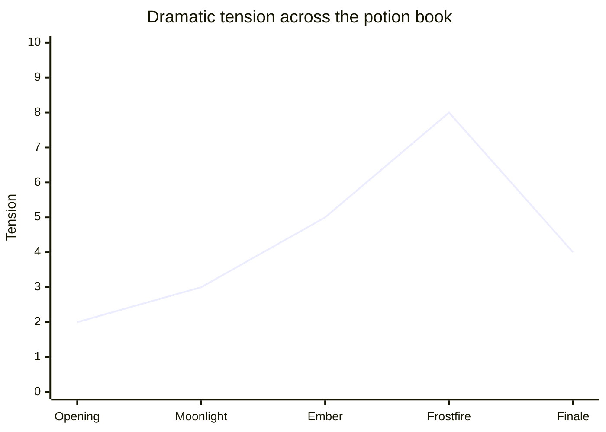

# The Alchemist's Missing Pages — Dramatic Elements

## 1. Challenge

### Skills required

The player is an apprentice alchemist reconstructing recipes whose spellbook instructions have been partially erased. Success requires: (1) interpreting incomplete written instructions; (2) identifying the correct ingredient on the shelf; (3) deciding whether an ingredient must remain raw, be **SLICE**d, **HEAT**ed, or receive both treatments; (4) measuring base liquid using the silver band on the cauldron gauge; (5) remembering ingredient order; (6) counting **MIX** actions; and (7) learning from feedback after **SERVE**.

These are concrete skills in the present code. `RecipeChecker.Check()` compares the cauldron with `RecipeData` and reports the first detected error: too little/much liquid, missing/extra ingredients, incorrect preparation, wrong ingredient order, or wrong stirring count. `JournalView` displays a bounded history of messages so experimentation has an observable record.

### Three selectable difficulty levels — proposed implementation

At the beginning of a new session, present **Apprentice / Alchemist / Master**. The selected level should modify recipe presentation and assistance, **not** silently change the required answer after a recipe begins.

| Parameter | Apprentice (easy) | Alchemist (normal) | Master (hard) |
|---|---|---|---|
| Recipe text | Ingredient names and preparation shown; only one small detail obscured | Current partial text, including `~~~` gaps | Several ingredient/preparation/count hints obscured |
| Silver liquid band | Wider visual band and explicit percentage hint | Existing `pourMin`–`pourMax` range | Narrower target band, displayed clearly |
| Incorrect attempts | Explain the first error and highlight its UI location | Existing first-error explanation | Explain the error category first; detailed explanation after repeated failure |
| Ingredient distractors | Only relevant ingredients plus one distractor | Current shelf selection | More visually distinct distractors |
| Mix count | Visible count | Partially erased count | Hidden count, inferable from clue and journal |
| Help | Contextual hint after 1 failure | Hint after 3 failures | Optional hint after 5 failures |

**Programming plan:** Add `DifficultyMode` enum and a `DifficultySettings` ScriptableObject. Keep the canonical `RecipeData` immutable. A `RecipePresentation` component uses the mode to generate displayed clues; a `RecipeRules` component may derive a separate validated liquid range. The `RecipeChecker` should receive the active effective rules rather than editing shared recipe assets at runtime. Test that all three modes remain solvable and that the displayed gauge matches the validated range.

### Dynamic difficulty adjustment — proposed implementation

Track per-recipe: attempts before success, consecutive failures, number of hint requests, repeated identical errors, and completion time (for analytics, **not** as a hard timer). Define a rolling performance score over the last three recipes. For example, 1 attempt without hints = strong mastery; 4+ attempts or 2+ hints = struggling. After two struggling recipes, offer a hint and simplify *the next recipe's presentation*. After two strong recipes, offer less explicit clues on the next recipe. Do not alter an in-progress recipe, and let the player disable adaptation.

Implement `PlayerSkillTracker` subscribing to the existing `potionBrewed` and `potionFailed` `GameEvent`s. The tracker also needs attempt counts and hint-use signals; those are **not currently present as a complete skill-tracking system**. Use hysteresis (two consecutive results) to prevent difficulty oscillating after every mistake.

## 2. Flow

### Focusing attention and reducing distractions

The main scene is a single 2D laboratory with shelf, workbench, cauldron, recipe book, and action controls. At any moment, emphasize only the next useful interaction: selecting an ingredient highlights it; holding an ingredient enables applicable preparation actions; pouring reveals the **STOP** control; serving triggers an outcome sequence. Keep the recipe page readable without covering the cauldron. Fade decorative effects during precision pouring. Avoid unrelated pop-ups while a brew action is running.

The existing `ActionRunner` runs **one** `BrewAction` coroutine at a time and exposes `IsBusy` / `RunningChanged`; this supports disabling conflicting actions during animations. `WorldPointer` separates UI clicks from world clicks, reducing accidental interactions.

### Agency and visible consequences

Every action must have an immediate response. **SLICE** or **HEAT** changes the held ingredient's preparation state and sprite; **TO THE POT** adds the prepared ingredient; **POUR** visibly raises the liquid level; **MIX** increments the mixing count; **SERVE** evaluates the entire sequence. `PrepSpellAction` already uses animation, spell-beam/effect timing, and `HeldIngredient.AddPrep()` to represent preparation. `PourBaseLiquid` increases the level until the player presses STOP or the vessel fills.

The player should be free to test an imperfect hypothesis and receive meaningful feedback. Avoid irreversible failure: after serving, the cauldron empties and another attempt is possible.

### Success and failure feedback

On success, `ServePotion` changes the liquid color, animates a beam into a vial, plays a happy animation, raises `potionBrewed`, writes a success journal entry, and advances `RecipeBook`. On failure, it raises `potionFailed`, plays `MishapReaction` with smoke and the apprentice's reaction, and reports the error through speech/journal messaging. The player learns *why* an attempt failed, rather than receiving only a generic red X.

## 3. Playfulness

### Optional activities

Allow players to experiment with **non-required ingredient combinations**, test whether a liquid can be sliced, combine incompatible preparation spells, or deliberately overfill the cauldron. These experiments should create harmless visual mishaps and journal observations. The current project already has `MishapReaction` and preparation compatibility checks; a separate collection of whimsical named reactions would be a **future addition**. The player should never lose the recipe book or become permanently blocked for experimenting.

### Player types

- **Achievers:** Completing every recipe, mastering difficult settings, earning optional badges for precise brewing.
- **Explorers:** Discovering combinations, ingredient reactions, and erased lore through experimentation.
- **Problem solvers:** Deduction from incomplete instructions and the first-error feedback.
- **Narrative-oriented players:** Uncovering why the spellbook pages disappeared and what each recovered recipe reveals.

### Broadening appeal

Offer optional hints, a relaxed mode without time pressure, readable symbols alongside colors, a compact recipe journal, and a separate challenge mode with efficiency medals. Avoid mandatory reaction-speed tasks: the core enjoyment is reasoning and experimentation.

## 4. Emotions

**Curiosity:** The book contains obscured instructions (`~~~` in `RecipeData.bookText`), encouraging the player to ask what is missing. The visual design should show ink stains, torn paper, and ingredient silhouettes.

**Anticipation:** Serving a potion is a short reveal. The cast animation, liquid color transformation, beam, and vial fill delay the verdict just enough to create suspense without making retries frustrating.

**Surprise and amusement:** Wrong preparations can produce smoke and an expressive apprentice animation, making mistakes entertaining rather than punishing.

**Frustration turning into understanding:** `RecipeChecker` reports a specific actionable mistake. Example: “Right ingredients, wrong order: [ingredient] goes in second.” This changes a failed attempt into information for the next experiment.

**Pride and mastery:** Successful brews produce a celebration and progress to the next recipe. The narrative should make each recovered page feel like a step toward restoring the alchemist's knowledge.

For accessibility, use iconography and text in addition to color and animation, and allow the player to replay hints.

## 5. Backstory

**Proposed story, consistent with the existing premise:** The apprentice inherits an old alchemist's laboratory and a spellbook whose pages were damaged or removed during a failed magical experiment. The surviving pages contain partial directions; the missing details can be reconstructed only by brewing and observing results. The apprentice hopes to restore the book before its remaining knowledge is lost.

The story is delivered through a short opening note inside the recipe book, marginal annotations on recipe pages, a line of apprentice dialogue after each success, and an epilogue after the final recipe. These story sequences are **planned additions**; the present prototype primarily conveys narrative through the laboratory, recipe names, book text, and reactions.

**Opening text example:** “The pages are torn, the measurements faded, and the old master's handwriting stops halfway through every spell. But the ingredients remember. Brew carefully, and the missing words may return.”

## 6. Characters

### Protagonist — the apprentice

The visible student/wizard is the player avatar. Rather than walking through the scene, the player directs their actions through clicks and the action bar. `StudentAnimator` already controls casting, idle, happy, and mistake reactions. Over the story, the apprentice moves from following obvious instructions to independently testing hypotheses.

### Main opposition — lost knowledge, not an enemy NPC

The central obstacle is the damaged spellbook and the risk of misinterpreting its instructions. The player faces incomplete information, incorrect ingredient order, and imprecise liquid quantities. There is **no implemented villain AI** in the supplied prototype. For a stronger narrative, the mysterious cause of the missing pages may be revealed gradually, but it should not replace the puzzle's logic.

### Supporting characters

The absent master alchemist can appear through handwritten notes, never requiring a fully animated NPC. An optional talking familiar could give hints after repeated mistakes; this is **not in the current code**. The apprentice's own speech and expressive animations already provide character feedback.

### Character development and apparent free will

The apprentice's reactions should vary with outcome: confidence after success, surprise after unusual combinations, and determination after repeated failure. NPC “free will” is unnecessary for the current single-player lab. If a familiar is added, use a small state machine (observing → offering hint → reacting) with contextual conditions rather than claiming autonomous intelligence.

## 7. Plot

### Dramatic arc

The horizontal axis represents story progression; the vertical axis represents tension/complexity. This is a **planned narrative curve**, not a measured value.



1. **Opening — the damaged book:** The apprentice discovers missing instructions and learns the basic lab controls.
2. **Moonlight Elixir — first discovery:** The sample recipe uses **Moonstone, SLICE, and two MIX actions**; the mixing count is partially hidden in the book text. This introduces experimentation with a manageable number of variables.
3. **Ember Tonic — rising complexity:** The sample recipe uses **heated Ember Root**, **sliced Nightbell Leaves**, and **raw Sun Honey**, in order, with **three MIX actions**. A partially erased preparation instruction creates uncertainty.
4. **Frostfire Brew — climax:** The sample recipe uses **sliced Frost Lily**, **sliced-and-heated Dragon Scale**, **heated Glowcap Mushrooms**, and **raw Star Essence**, in order, with **four MIX actions**. More ingredients and combined preparations demand greater planning.
5. **Finale — knowledge restored:** Completing the available recipes reveals a concluding page or message. **Currently**, `RecipeBook.Advance()` cycles to the first recipe after the last; the final story reveal is a proposed addition.

### How player behavior changes the plot

The main recipe sequence is linear in the current code: a correct potion advances the book. Wrong attempts create different speech/journal feedback, but do not branch into separate levels. For the proposed story layer, optional discoveries can affect a final epilogue: an apprentice who studies many reactions becomes a careful researcher; one who focuses on rapid successful brews becomes a practical master. Neither route should lock out the core game.

### Twine branching story deliverable

The assignment additionally requires a **playable HTML exported from Twine**. This Markdown file documents the proposed story but is **not itself** a Twine export. A separate HTML/Twine artifact must be created and submitted. Suggested passages and branches:

```text
Start: Find the damaged book
  -> Read the master's note -> StudyFirst
  -> Go straight to the cauldron -> ExperimentFirst
StudyFirst / ExperimentFirst -> Moonlight
Moonlight -> SuccessMoonlight / FailureMoonlight
FailureMoonlight -> ReviewJournal -> Moonlight
SuccessMoonlight -> Ember
Ember -> SuccessEmber / FailureEmber
FailureEmber -> ReviewJournal -> Ember
SuccessEmber -> Frostfire
Frostfire -> SuccessFrostfire / FailureFrostfire
FailureFrostfire -> ReviewJournal -> Frostfire
SuccessFrostfire -> FinaleCareful / FinaleBold
```

The branch choices are narrative; actual potion success remains determined by the Unity recipe rules.

## 8. Worldbuilding

**Nature:** Ingredients respond consistently to preparation and brewing rules. Each `IngredientData` defines which preparations are allowed (`canBe`) and what color it contributes. `RecipeData` specifies acceptable liquid range, ordered steps, preparation state, and mixing count. Magic is repeatable and discoverable, not random punishment.

**Geography:** The current playable space is a compact 2D potion laboratory with shelves, cauldron, kettle, workbench, spellbook, and journal. Future spaces (library, herb garden, storeroom) can appear as recipe-book illustrations or later scenes, without requiring free-roaming movement in the current prototype.

**History:** The book belonged to an earlier alchemist; pages were lost during an experiment. Different ingredient names and recipe annotations imply an older craft tradition. This historical detail is proposed story material.

**Economy:** Ingredients are the resources of alchemy. In the current prototype, the core puzzle does not implement a verified currency/shop system. If resources are added later, preserve infinite recovery or replenishment so players cannot soft-lock the puzzle by experimenting.

**Society and politics:** The world values alchemical knowledge, apprenticeships, and the responsibility to document discoveries. There is no implemented faction or political simulation; any guild politics should remain background flavor unless supported by gameplay.

**Teaching the world:** The first recipe acts as a tutorial. Ingredient names and preparation sprites convey physical rules; recipe book text provides incomplete knowledge; the journal records observed outcomes; failure messages explain specific causal relationships.

## 9. Metagame

The best fit is a **collection-and-mastery metagame** built around reconstructing the book. Each successfully brewed potion restores a page. Optional goals reward completing recipes without hints, using few attempts, or discovering special reactions. A progress overview could show `pages restored / total pages`, with silhouettes for unknown recipes.

The existing `RecipeBook` provides ordered progression and a `Changed` event, while `JournalView` shows recent messages. However, `JournalView` currently stores only a bounded in-memory list (default maximum 14 lines), and `RecipeBook` cycles after the last recipe. **Persistent unlocked pages, medals, and cross-session journal saving are proposed features, not current behavior.**

**Implementation plan:** Add `PlayerProgress` with recipe IDs, best attempt count, discovered reactions, and unlocked pages. Save only compact progress data using a versioned JSON file or `PlayerPrefs` for a small prototype. Load on startup, update after `potionBrewed`, and offer Reset Progress. Do not overwrite the actual `RecipeData` assets with player progress.

<div dir='rtl' lang='he'>

## 10. ניהול חי (Live Ops)

### הרעיון

כל ההגדרות של האירועים החיים נמצאות בקובץ JSON אחד במאגר שלנו בגיטהאב: `LiveOps/live-config.json`.
המשחק מוריד את הקובץ בכל הפעלה. לכן כדי להתחיל, לשנות או לעצור אירוע מספיק לערוך את הקובץ בגיטהאב ולעשות commit. השינוי מגיע לכל השחקנים, בלי לבנות גרסה חדשה ובלי להעלות מחדש ל-itch.io.

### טעינה דינמית של הקונפיגורציה

הקוד נמצא בתיקייה `Assets/Scripts/LiveOps`. לכל מחלקה יש תפקיד אחד, והמחלקות מדברות זו עם זו דרך אירועים.

1. **`LiveConfigLoader` מביא את הקונפיגורציה.** בתחילת המשחק הוא מוריד את הקובץ עם `UnityWebRequest` מהכתובת:
   <div dir='ltr'>

   `https://raw.githubusercontent.com/Gamedev-HW/The-Alchemists-Missing-Pages/main/LiveOps/live-config.json`

   </div>
   אם ההורדה נכשלה (אין אינטרנט, timeout של 5 שניות, או JSON לא תקין), הוא משתמש בגיבוי, לפי הסדר:
   - העותק שנשמר בהפעלה הקודמת (`PlayerPrefs`)
   - קובץ ברירת המחדל שנבנה לתוך המשחק: `Assets/Data/LiveOps/live-config-default.json` (בלי אירועים)

   כך המשחק תמיד עולה, גם בלי רשת. בסוף הוא מפרסם את הקונפיגורציה באירוע `Live Config Loaded` (אירוע ScriptableObject). הוא לא יודע מה יעשו איתה.
2. **`LiveEventDirector` מפעיל את האירוע של היום.** הוא מאזין ל-`Live Config Loaded` ובוחר את האירוע הפעיל: הראשון ברשימה שהתאריך הנוכחי (UTC) נמצא בין `startUtc` ל-`endUtc`. אחר כך הוא מפעיל אותו רק דרך ממשקים ואירועים שכבר קיימים במשחק:
   - מוסיף את מתכון האירוע לספר (`RecipeBook.Insert`), והוא הופך למתכון הנוכחי. אחרי שמבשלים אותו, הספר ממשיך מאיפה שהיה.
   - צובע את החדר: מעלה את האירוע `Room Mood`, והרכיב `RoomMood` מעביר בהדרגה את הרקע לצבע החדש.
   - התלמיד מכריז על האירוע (`Student Says`), ונכתבת שורה ביומן (`Journal Entry`).
   - כשהשחקן מבשל בהצלחה את מתכון האירוע (האירוע `Potion Brewed`), התלמיד אומר את הודעת ההצלחה של האירוע.
3. **`LiveRecipeFactory` הופך מתכון מה-JSON ל-`RecipeData` רגיל.** המרכיבים מזוהים לפי ה-id שלהם (`moonstone`, `silver_dew`...), וההכנה לפי שם (`Raw`, `Sliced`, `Heated`, `SlicedHeated`). לכן `RecipeChecker`, הספר והממשק לא צריכים לדעת שהמתכון הגיע מהרשת. מתכון עם מרכיב שלא קיים מדולג, ומופיעה אזהרה ב-Console.

**השדות של כל אירוע בקובץ:**

| שדה | משמעות |
|---|---|
| `id`, `title` | מזהה ושם שמופיע ביומן |
| `startUtc`, `endUtc` | מתי האירוע פעיל (בשעון UTC) |
| `startMessage`, `successMessage` | מה התלמיד אומר כשהאירוע מתחיל, וכשמבשלים בהצלחה את המתכון שלו |
| `roomTint` | צבע (hex) שצובע את החדר בזמן האירוע |
| `recipe` | מתכון מיוחד: שם, טקסט בספר (אפשר להשאיר חלקים מרוחים עם `~~~`), טווח המזיגה, הצעדים, האם הסדר חשוב, מספר הערבובים וצבע השיקוי |

### אירוע חי לדוגמה: "ליל ירח מלא" (Full Moon Night)

האירוע פעיל מ-23/11/2026 עד 15/1/2027:

<div dir='ltr'>

```json
{
  "id": "full-moon-night",
  "title": "Full Moon Night",
  "startUtc": "2026-11-23T00:00:00Z",
  "endUtc": "2027-01-15T00:00:00Z",
  "startMessage": "The full moon is up! A special recipe appeared in the book: the Silver Moon Draught.",
  "successMessage": "Full Moon Night: you brewed the Silver Moon Draught!",
  "roomTint": "#B4C3FF",
  "recipe": {
    "potionName": "Silver Moon Draught",
    "bookText": "FULL MOON SPECIAL\n1. POUR to the silver band.\n2. Silver Dew, just as it is.\n3. Moonstone, ~~~~~~ (moonlight hides the word).\n4. MIX ~~ times and SERVE.",
    "mixTimes": 3,
    "color": "#DDE4FF",
    "steps": [
      { "ingredient": "silver_dew", "prep": "Raw" },
      { "ingredient": "moonstone", "prep": "Sliced" }
    ]
  }
}
```

</div>

**מה השחקן רואה בזמן האירוע:**
1. כמה שניות אחרי שהמשחק עולה, החדר נצבע בהדרגה באור ירח כחלחל.
2. התלמיד מכריז שהופיע מתכון מיוחד, וביומן נכתב "LIVE EVENT: Full Moon Night".
3. בפינה מופיע "Recipe 1/2: Silver Moon Draught", ובספר המתכונים מופיע המתכון החדש. מילת ההכנה של אבן הירח מרוחה, כדי שהשחקן יגלה בניסוי שצריך לחתוך אותה.
4. אחרי SERVE מוצלח התלמיד אומר את הודעת האירוע, והספר עובר למתכון הרגיל (Moonlight Elixir).

**אירוע מתוזמן מראש:** בקובץ יש גם אירוע שני, "Winter Solstice" (21–22/12/2026), עם מתכון חם וצבע כתום. הוא מופיע ראשון ברשימה, ולכן בשני הלילות האלה הוא מחליף אוטומטית את ליל הירח המלא, בלי שאף אחד צריך להיות מחובר באותו רגע.

### איך מפעילים, משנים ועוצרים אירוע

1. **עורכים את הקובץ:** פותחים בגיטהאב את `LiveOps/live-config.json`, לוחצים על העיפרון, משנים (תאריכים, הודעות, מתכון, צבע) ועושים commit.
2. **השינוי מגיע לשחקנים:** הוא מופיע אצל השחקנים בהפעלה הבאה של המשחק. השרת של גיטהאב שומר עותק עד כ-5 דקות, כך שלפעמים צריך לחכות קצת.
3. **עוצרים אירוע:** משנים את `endUtc` לתאריך שעבר, או מוחקים את האירוע מהרשימה.
4. **בודקים את ה-JSON לפני ה-commit,** למשל ב-jsonlint.com. אם הקובץ שבור, המשחק מתעלם ממנו ומשתמש בעותק השמור, כך ששגיאה לא תשבור את המשחק לשחקנים.

### איך בודקים אירוע לפני שהוא מתחיל

ב-Unity בוחרים את `Game ▸ Live Ops` ובשדה **Pretend Date** של `Live Event Director` כותבים תאריך, למשל `2026-12-21`, ולוחצים Play. המשחק מתנהג כאילו היום הוא התאריך הזה ומפעיל את האירוע של היפוך החורף. משאירים את השדה ריק כדי לחזור לתאריך האמיתי.

### הרחבות אפשריות

- **"ידיים רגועות" בסוף שבוע:** מוסיפים ל-`LiveEvent` שדה `pourSpeedMultiplier`. `PourBaseLiquid` מאזין ל-`Live Config Loaded` ומכפיל את מהירות המזיגה, כך שקל יותר לעצור בפס הכסוף.
- **מרכיב מככב:** מוסיפים שדה `featuredIngredient`. `ShelfItem` של המרכיב הזה מאזין לאירוע ומדליק את ההילה שלו כל הזמן.
- **עמוד יומן מיוחד:** מוסיפים שדה `journalPage` עם טקסט, ש-`JournalView` מציג בתחילת היומן בזמן האירוע.

בכל ההרחבות האלה מוסיפים שדה לקובץ ומאזין אחד, ושום מחלקה קיימת לא צריכה להכיר את המחלקה החדשה.

</div>

---

## Technical mapping to the submitted Unity code

| Current source | Existing responsibility | Dramatic element supported |
|---|---|---|
| `Assets/Scripts/Recipes/RecipeData.cs` | Recipe text, liquid bounds, ingredient steps, order and mix count | Challenge, world rules |
| `Assets/Scripts/Recipes/RecipeChecker.cs` | Deterministic validation and first-error feedback | Learning, flow, emotions |
| `Assets/Scripts/Recipes/RecipeBook.cs` | Current recipe and sequential advancement | Plot progression, metagame foundation |
| `Assets/Scripts/Actions/ActionRunner.cs` | Runs one coroutine action at a time | Focus and control |
| `Assets/Scripts/Actions/PrepSpellAction.cs` | SLICE/HEAT effects and ingredient preparation | Agency, visual feedback |
| `Assets/Scripts/Actions/PourBaseLiquid.cs` | Timed pouring and STOP control | Skill and precision |
| `Assets/Scripts/Actions/ServePotion.cs` | Success/failure and recipe progression | Climax, reward and learning |
| `Assets/Scripts/Actions/MishapReaction.cs` | Smoke, apprentice reaction, journal message | Humor and emotional feedback |
| `Assets/Scripts/UI/JournalView.cs` | Recent experiment messages | Reflection and experimentation |
| `Assets/Scripts/Events/EventChannel.cs` | ScriptableObject-based typed events | Extensible game architecture |
| `Assets/Editor/Data/SampleRecipes.cs` | Three sample recipes and their target steps | Plot's three brewing challenges |